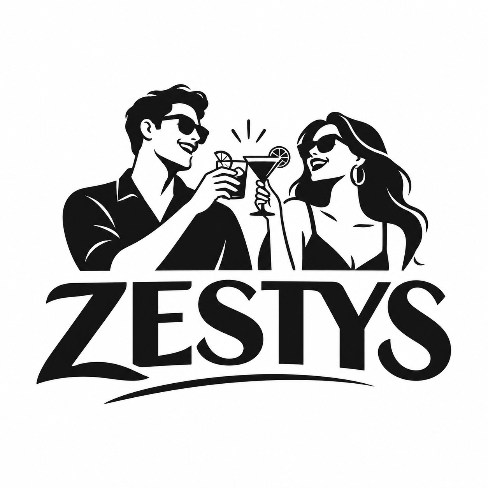

  

<h1 align="center">Get on the list. Stay zesty.</h1>

  Good people. Bigger vibes. Something worth being part of.

  <a href="https://github.com/zestys/list"><strong>Explore the list →</strong></a>
  &nbsp; · &nbsp;
  <a href="https://github.com/orgs/zestys/repositories">Our projects</a>

---

## A little zest goes a long way.

Zestys is about good company, shared energy, and making room for the next great connection. This is where we bring that spirit to the things we build.

### Start with the list

[**zestys/list**](https://github.com/zestys/list) is our first stop: a growing collection of handles, organized so they're easier to find, explore, and work with.

### Inside this repository

This repository is the home of our GitHub identity: the organization profile, shared imagery, and the words that welcome people to Zestys.

| Location | What's inside |
| --- | --- |
| [`profile/README.md`](profile/README.md) | The welcome page on the Zestys organization profile |
| [`assets/`](assets/) | Our banner and logo |

---

  

<strong>Same friends. Bigger vibes.</strong> Stay zesty.

